# TARS

TARS is the shared home for local multi-agent orchestration: reusable skills,
durable handoff protocols, and automation that coordinate CLI harnesses through
Agent of Empires (AoE).

Its current workflow creates one lane per git worktree. You select an author
and reviewer harness independently; TARS wakes the role-bound sessions until
the approved branch is ready for a pull request. The same harness can fill both
roles in separate sessions.

## Supported harnesses

TARS currently supports these AoE-backed harnesses in either role:

- OpenCode
- Codex
- Claude Code
- Cursor

`node setup.mjs` discovers which are installed locally, lets you select default
roles, and provisions TARS requirements for every supported installed harness.
It also installs the TARS-owned `tars` controller command in `~/.local/bin`.

## Prerequisites

Before continuing, make sure the following commands are available in the
environment where AoE launches agent sessions:

- A recent [Node.js runtime](https://nodejs.org/en/download) with `node:sqlite`
  support.
- [tmux](https://github.com/tmux/tmux/wiki/Installing) and
  [Agent of Empires (AoE)](https://github.com/agent-of-empires/agent-of-empires/blob/main/docs/installation.md)
  installed and usable as `aoe`. AoE's tmux-backed sessions must be able to
  launch the author and reviewer harnesses selected during setup.
- At least one supported harness installed and authenticated for each role you
  intend to use. Setup offers only harnesses reported as installed by
  `aoe agents`. If using Codex from the ChatGPT desktop app, expose its
  executable on `PATH` before launching AoE.
- [GitHub CLI (`gh`)](https://cli.github.com/manual/) authenticated for the
  target project; `lane start` reads the issue title and body.
- A target Git repository whose TARS-provisioned shared skills describe how to
  work its issues (for example, its issue-kickoff workflow).

## One-time setup

Clone TARS, then install the default TARS skills and portable controller command
for fresh agent sessions with one command:

```bash
git clone https://github.com/satwikhebbar/tars.git
cd tars

node setup.mjs
```

To install skills selectively, use the skill installer directly:

```bash
# Install or update one Codex skill.
node skills/install.mjs codex handoff-review --force

# Install an additional OpenCode skill used by your project.
node skills/install.mjs opencode close-issue --force
```

`setup.mjs` discovers installed AoE harnesses, asks for default author and
reviewer roles on first run, and updates every supported installed harness's
TARS-managed requirements. Run this non-interactive command after adding a
supported harness to your device:

```bash
node setup.mjs provision
```

This refreshes only TARS-owned global files, including the `tars` command.
Ensure `~/.local/bin` is on `PATH` in the environment that launches AoE and its
agent sessions. Cursor's required rule is
worktree-local, so TARS provisions it when a Cursor lane is created. Selective
installers copy skills into the agent's global configuration, so use `--force`
when updating one that is already installed. Start new AoE sessions after an
update; an already-running agent may still have its earlier skill instructions
in context.

Lane creation can also copy project-local files from the source repository into
each new worktree. Add a `worktreeFiles` array to
`<repository>/.tars/config.json`; paths are relative to the `--repo` root and
the worktree respectively. A string uses the same relative path for both sides,
while an object can rename it:

```json
{
  "worktreeFiles": [
    ".env.local",
    { "source": "config/dev.local.json", "destination": "config/local.json" }
  ]
}
```

TARS merges this repository-local configuration with device defaults from
`~/.config/tars/config.json`, with repository values taking precedence. TARS
copies these entries after AoE creates the worktree and before the author
session receives its opening prompt. Source entries must exist; absolute paths
and paths that escape either root are rejected. Keep `.tars/` ignored when the
configuration names local secrets or machine-specific paths.

### OpenCode planning agent

For a plan-first lane with OpenCode as author, TARS launches its custom
`tars-plan` agent rather than OpenCode's built-in read-only `plan` agent. TARS
needs the author to revise and commit the durable plan and publish review
handoffs while keeping implementation work gated on plan approval. The custom
agent is therefore scoped to planning artifacts and handoffs, then TARS moves
the author to OpenCode Build mode after plan approval. TARS switches the live
primary session to OpenCode's native `build` agent and verifies the visible
agent before sending implementation work, so subsequent turns remain in Build
mode rather than returning to `tars-plan`.

This is currently the only harness-specific planning agent. Other supported
author harnesses use their normal author mode; TARS may add equivalent agents
as their planning behavior and permissions are validated. The supported opt-out
is `--planning never`, which runs TARS's direct Build → review workflow. There
is no opt-out that substitutes OpenCode's built-in read-only Plan agent while
retaining TARS plan-review handoffs.

## Start using TARS

Run one long-lived watcher from the TARS checkout. It serves every registered
lane and prints only dispatched handoff events, so quiet output means no new
handoff needed delivery.

```bash
tars watch
```

In another terminal, create a lane for an issue. TARS asks the selected author
for a bounded branch/worktree suggestion when its harness supports preflight,
lets AoE create the worktree and role-bound sessions, then sends the author the
appropriate opening prompt. Defaults come from `setup.mjs`; pass `--author` and
`--reviewer` to override them for this lane:

```bash
tars lane start \
  --repo /absolute/path/to/main-checkout \
  --issue 44 \
  --author opencode --reviewer codex \
  --planning auto
```

To prepare a newly launched Codex/OpenCode lane for active-lane investigation,
add `--investigate capture`. TARS configures native capture before either role
starts. Native harness stores remain authoritative.

`tars lane evidence --issue <number>` (or `--worktree <path>`) builds an
immutable local SQLite snapshot when none is usable, checking that both AoE
roles are idle or waiting before and after collection. It reports snapshot ID,
cutoff, expiry, database size, source availability, and coverage gaps. A missing
role does not hide the other role's evidence. This command requires an active,
capture-enabled lane. It reuses an existing snapshot without exporting or
checking for newer evidence; `--force` creates a fresh snapshot. Reuse does not
extend expiry. The former `--index` option has been removed.

Snapshots live under
`$XDG_CACHE_HOME/agent-review-loop/evidence-indexes/<hashed-lane>/<snapshot-id>/`,
defaulting to `~/.cache/agent-review-loop/evidence-indexes/`. Each private
directory contains `evidence.sqlite` and `manifest.json`. A shared
`cache-lock.sqlite` serializes collection and cleanup. Snapshots expire seven
days after creation; preparation and `tars lane prune-indexes` remove expired,
unleased snapshots. `tars lane indexes` lists snapshot IDs, sizes, expiry, and
paths. `tars lane remove-index --snapshot-id <id>` removes only that snapshot.
Cleanup never removes native exports or Codex trace bundles. Reader leases pin
snapshots until release; dead local reader processes and interrupted staging
builds are recovered during cache mutation.

OpenCode exports and Codex reduced traces first go to private temporary files,
removed on success or failure. Snapshot collection accepts OpenCode exports
above the old 16 MiB diagnostic limit. JSON parsing and indexing still require
memory proportional to the selected artifacts. The cache preserves all fields
of the chosen JSON artifacts, with shared large strings stored in bounded
chunks; reduced traces can omit upstream raw payloads. The versioned event
normalization inventory is `lib/investigation-records.mjs`. Unsupported commands
remain available as native data. TARS derives individual event facts and
assigns events to dispatch intervals, with approximate boundaries labeled for
older lanes. Journal markers contain metadata and refer to native opening
messages; they do not copy dispatch prompts. This command offers no navigation
judgment. Progressive evidence queries are described below; snapshot-based
analysis remains a later iteration.

### Progressive evidence queries

Use the snapshot ID printed by `lane evidence` for read-only queries:

```sh
tars lane evidence overview --snapshot-id <id>
tars lane evidence list_events --snapshot-id <id> --role author --action search
tars lane evidence get_event_details --snapshot-id <id> --event-id <event-id>
tars lane evidence get_event_content --snapshot-id <id> --event-id <event-id> --field <field-id> --line-start 1 --line-end 20
```

Responses are JSON. Pass `--cursor <nextCursor>` with the same command and
filters to continue. The event listing supports block, source, message, role,
event type, tool name, normalized action, exact path, directory subtree, exact
search query, minimum visible output bytes, and inclusive timestamp filters.
Path/query comparisons are literal and case-sensitive; subtree matching uses
a directory separator, so `src` does not match `src-old`. Paths are not
resolved against the current filesystem. There are no regex, aggregation or
SQL commands. Records without classified paths remain in the unfiltered list.

Events carry native source position, compaction context, block uncertainty,
typed attributes and content-field references. Ordering is stable within each
source: OpenCode native record order; Codex known timestamps then native
position, with untimed records last. Different sources have independent
context IDs. Uncertain Codex compaction ordering is reported as unknown.
Paired Codex tool/terminal records remain separate and linked; counts describe
records and must not be interpreted as counts of executed commands.

`get_event_details` lists one level of native fields. Use a returned field ID
or `--field-path <JSON-pointer>` to descend into an object/array. Large values
remain references. `get_event_content` retrieves string fields by ID; it
supports one-based inclusive line ranges or zero-based byte ranges with an
exclusive end. Text with no line breaks uses byte ranges. A selected range may
still require multiple pages; byte endpoints must land on UTF-8 character
boundaries. Long native field names are accessible with `--field-key` and
their field ID. OpenCode parent message events expose references to their
text parts and a source/message filter to retrieve all parts.

Text-field references in events/details include `contentTokenEstimate` for
the full stored text, computed once during indexing. Content responses include
`contentTokenEstimate` for the returned text and `totalContentTokenEstimate`
for the full stored body (or field key). Each estimate names its method and
scope. Long bodies are counted in bounded pieces, preferring whitespace boundaries,
and labeled `chunked-estimate`;
token boundaries can make these totals differ from counting the text in one
pass. Upstream truncation or omissions still limit what the stored body represents.
These content estimates are separate from serialized response estimates and
native harness usage, and do not establish exact billed cost. Snapshot format
4 adds cached estimates; older snapshots are not reused and are rebuilt on
the next evidence collection.

Overview/events/details responses are capped at 16 KiB and 4,000 estimated
tokens; content responses at 8 KiB and 2,000 estimated tokens. Caps include
the final JSON envelope, escaping and stdout newline. Page sizes follow these
limits rather than an event-count limit. Each response reports its serialized
bytes, estimated tokens and counting method. Install the pinned local
tokenizer with:

```sh
npm --prefix automations/review-loop ci --ignore-scripts
```

The tokenizer uses locally installed `o200k_base` ranks; no evidence is sent
to a provider or downloaded during queries. When unavailable, responses label
the fallback estimate of four characters per token. Estimates describe the
response and are not a measurement of the analyst's model or session context.

Operator queries acquire a short reader lease and release it after closing
SQLite. The analyst launcher holds a lease for the entire analysis;
queries borrowing that lease perform no cache writes. Queries open no lane
state database and never re-collect sources.

Run `tars lane investigate --issue <number>` (or `--worktree <path>`) for
repository navigation diagnosis. The default built-in is `navigation-efficiency`;
its versioned instructions live in `automations/review-loop/questions/`.
Use `--ad-hoc "<question>"` with optional `--report-guidance "<instructions>"`
for another question. Both modes share evidence retrieval, analysis guidance,
report structure and validation.

Investigation implicitly prepares or reuses the lane's immutable SQLite snapshot.
Both AoE sessions must be idle or waiting at launch, and both role evidence sources
must be available (partial sources with recorded gaps are allowed). Collection
prints the snapshot time, cutoff, size and gaps. Reuse does not refresh native
evidence: run `lane evidence --force` before investigating newer activity. Work
resuming after launch does not change the fixed snapshot being analyzed.

A separate Codex analyst receives the first bounded overview page and the
progressive evidence CLI. It chooses which events/bodies to inspect and derives
patterns itself. There is no whole-projection token gate, block-selection mode,
query audit trail or session token budget. The harness manages its context;
per-response token estimates help it page evidence. Codex is also used for an
OpenCode-authored lane. The model defaults to the lane's Codex author/reviewer
model when present; `--analyst-model <model>` overrides it. The analyst incurs
model cost.

The analyst runs from a private temporary directory with `workspace-write`,
no added writable roots, no writable shared temporary directories, no network
access for its tools, and no approval escalation. Repository/cache access is
read-only. User configuration and exec rules are not loaded for this constrained
session. A lifetime reader lease protects the snapshot; query commands borrow
it without writing to the cache. The session is persisted by Codex so a correction
can resume it; TARS does not store analyst transcripts or reports.

The analyst writes `answer.json`, following the generic version-one shape in
`lib/investigation-report.mjs`: snapshot/question identity, whole-lane or partial
scope, Markdown summary, findings with block IDs and Markdown analysis, material
limitations, conclusion and a citation registry. Inline `{{cite:<id>}}` markers
place citations beside the claims they support. Registry entries identify either
an indexed event or a repository commit/path with an optional line. Short relevant
excerpts are allowed. The analyst self-validates using
`lane investigate validate-report --file <answer.json> --context <assigned-context.json>`.
This command opens no lane registry. TARS validates the file again after completion,
checks schema and references (repository commit/path in local Git, not line meaning
or diagnosis), and requests at most one correction in the same session.

TARS deterministically renders valid reports as Markdown. `--output <markdown-path>`
exports the report; otherwise it is printed only. Existing files are never
overwritten. Snapshot time and cutoff appear in the report. The temporary answer,
context and process-output files are removed, and the lease is released on success,
validation/process failure, timeout or handled interruption. SIGKILL cannot run
cleanup; the next cache mutation reclaims its dead owner's lease, while the OS may
retain the private temporary run directory until normal temporary-file cleanup.

Codex's optional rollout trace bundles are written under
`$CODEX_HOME/tars/rollout-traces/lane-<lane-id>/<role>/`. When `CODEX_HOME` is
unset, the location is `~/.codex/tars/rollout-traces/...`. This is a TARS
convention inside Codex's home; Codex itself does not define a default root for
optional trace bundles. Each Codex role has a separate directory, apart from
ordinary Codex session rollouts under `$CODEX_HOME/sessions/`. OpenCode evidence
continues to live in OpenCode's native session store. TARS does not copy these
native records into TARS state or prune trace bundles automatically; operators
can remove a lane directory when its evidence is no longer needed.

For a capture-enabled OpenCode role, TARS starts a loopback OpenCode server in
the lane worktree, creates the native session through its API, and launches AoE
with an attach command for that exact session ID. The ID, server port, and
process ID are stored only in the active lane row. `tars lane recover` starts a
stopped server on the recorded port before restarting the AoE session.
`tars lane resume --create-sessions` creates a new native session for a
missing role and retains its earlier IDs in the active lane row. Closing the
lane stops these loopback servers; OpenCode's native session history remains in
OpenCode's own store.

AoE may require a one-time acknowledgement of its agent hook paths before it
launches Codex or OpenCode sessions on this machine. If lane start reports that
the paths have not been acknowledged, open the AoE TUI, create a temporary
Codex or OpenCode session, review and accept the hook acknowledgement dialog,
then remove the temporary session and retry.

```bash
tars lane start \
  --repo /absolute/path/to/main-checkout \
  --issue 21 \
  --author opencode --reviewer codex \
  --planning never \
  --investigate capture
```

Use `--planning always` to require a plan-first lane, or `--planning never`
for direct implementation. A plan-first lane can use a configured planning
model:

```bash
tars lane start \
  --repo /absolute/path/to/main-checkout \
  --issue 44 \
  --planning always \
  --plan-model deepseek/deepseek-flash
```

Use a provider/model identifier understood by OpenCode, such as
`deepseek/deepseek-flash`. TARS also accepts `--author-model` and
`--reviewer-model` for per-lane overrides. To configure defaults, add role
defaults under the selected harness in the global or repository `.tars/config.json`:

```json
{
  "harnesses": {
    "codex": {
      "defaults": {
        "author": { "model": "gpt-5.6-terra" },
        "reviewer": { "model": "gpt-5.6-terra" }
      }
    },
    "opencode": {
      "defaults": {
        "author": { "model": "<author-model>" },
        "planning": { "model": "deepseek/deepseek-flash" }
      }
    }
  }
}
```

Repository configuration overrides global configuration, and explicit CLI
model flags override both.

TARS prints the worktree path, author session ID, reviewer session ID, and
branch. Use AoE's normal tmux interface to observe either session; do not
create a second session for either role in the same lane.

## Review-loop lifecycle

```mermaid
flowchart TD
  subgraph plan_first["Plan-first lane"]
    plan["Author writes a plan"] --> plan_handoff["Plan-review handoff"]
    plan_handoff --> plan_review["Reviewer reviews the plan"]
    plan_review --> plan_approved["Approved verdict + iteration schedule"]
    plan_approved --> start_iteration["TARS starts iteration 1 in Build mode"]
    start_iteration --> build["Author commits an implementation response"]
    build --> code_review["Reviewer reviews the code"]
    code_review -->|"Changes requested"| revise["Author revises the same iteration"]
    revise --> build
    code_review -->|"Approved; more iterations remain"| next_iteration["TARS starts the next iteration"]
    next_iteration --> build
    code_review -->|"Final approval"| create_pr["Author pushes the branch and creates a PR"]
  end

  subgraph direct_build["Direct-build lane"]
    direct_commit["Author commits an implementation response"] --> direct_review["Reviewer reviews the code"]
    direct_review -->|"Changes requested"| direct_revise["Author revises and commits"]
    direct_revise --> direct_commit
    direct_review -->|"Approved"| direct_pr["Author pushes the branch and creates a PR"]
  end

  subgraph pr_feedback["Existing PR feedback"]
    feedback["Ask the author to use address-pr-feedback"] --> follow_up["Author commits a marked follow-up handoff"]
    follow_up --> reopen["TARS reopens the approved lane for reviewer review"]
    reopen --> feedback_review["Reviewer reviews the follow-up"]
    feedback_review -->|"Changes requested"| feedback_revise["Author repairs and commits"]
    feedback_revise --> follow_up
    feedback_review -->|"Approved"| feedback_push["Author pushes the follow-up to the existing PR"]
  end
```



The reviewer uses an approved plan verdict to recommend the smallest sensible
set of independently buildable and testable iterations. On approval the verdict
also selects the implementation's review budget — either `review_budget` (an
explicit total) or `review_budget_per_iteration` (allowance × `iteration_count`).
TARS persists it separately from the pre-approval `max_rounds` plan-review cap;
only reviewer `changes_requested` cycles consume it, and the lane blocks with
reason `review_budget` when it is exhausted. Raise it to recover:
`tars lane set-max-rounds --worktree <path> --review-budget <n> --resume`.
TARS stores the current
iteration per worktree, so multiple plan-first and direct-build lanes can
advance concurrently without crossing handoffs.

After you or a GitHub-integrated reviewer leaves feedback on an approved PR,
ask the lane's existing author session to use `address-pr-feedback`. It reads
the existing PR feedback, commits and publishes an explicit reopen handoff, and
leaves delivery to the shared watcher. No second lane or pull request is made.

## Day-to-day lane commands

```bash
# Inspect all persisted lanes.
tars status

# Register an already-created AoE author/reviewer pair; the shared watcher serves it.
tars lane register --worktree /absolute/path/to/worktree

# Start a one-off watcher while registering an existing pair (advanced use).
tars start --worktree /absolute/path/to/worktree

# Retire a merged, approved lane. This also works if an invalid stale handoff
# temporarily masks an otherwise approved lane. AoE removes its own worktree
# and branch.
tars lane close --issue 44

# Abort only after both registered AoE panes have been stopped and are dead.
tars lane close --issue 44 --force

# Diagnose a stuck or interrupted lane from durable handoffs and session liveness (read-only).
tars lane resume --issue 44
```

See the [review-loop reference](automations/review-loop/README.md) for all
flags, persisted state, and handoff metadata. The canonical skill packages are
under [`skills/`](skills/), and the tool-neutral handoff contract is under
[`protocols/`](protocols/).
